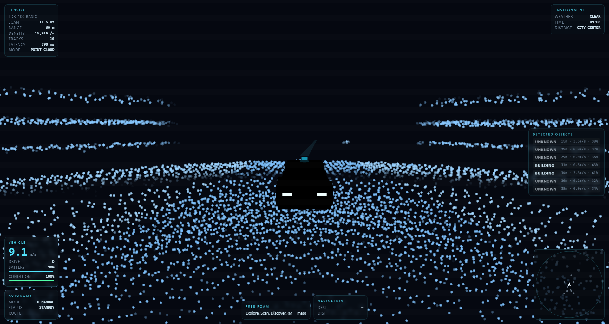

# PERCEPTION

**A LiDAR Driving Simulator** — *The world is invisible. Your sensors are your eyes.*

You don't see the road. You understand it.

PERCEPTION is a futuristic driving simulator where the world is fully modeled in 3D but never
rendered as ordinary geometry. Instead, an onboard simulated LiDAR scans the environment and the
world exists for you only as a living point cloud — with realistic occlusion, measurement noise,
range limits, processing latency and object recognition. Drive, scan, perceive, complete missions,
earn credits and research data, and upgrade your vehicle from a basic sensor platform into a
fully autonomous machine.



## Features

- **Simulated LiDAR pipeline** — scan generator → environment raycast queries → measurement
  processor (noise, dropout, reflectivity, weather degradation) → latency queue → pooled point
  cloud renderer. Occlusion is real: objects hide what is behind them. Scan persistence — how
  long points stay visible — is adjustable in Settings.
- **7 visualization modes** — Point Cloud, Distance, Height, Intensity, Detection (bounding
  boxes), Semantic and Wireframe (advanced modes unlock through research).
- **7 sensor tiers** (LDR-100 BASIC → LDR-X EXPERIMENTAL) with independent scan frequency,
  range, channels, angular resolution, noise, latency and recognition quality.
- **8 upgrade categories** — scan frequency, point density, vertical channels, range, object
  recognition, environmental filtering, AI processing unit, calibration.
- **5 vehicles** — Compact EV, Electric Sedan, Electric SUV, Performance EV, Autonomous Prototype.
- **6 autonomy modes** — from Manual and Driver Assist (AEB) through Active Assist (ACC + lane
  keeping) to Supervised, Advanced and Experimental autonomy. The driving AI consumes **only**
  perception output: when the road estimate loses confidence, the vehicle slows down and stops —
  exactly like a real autonomous stack.
- **6 campaign chapters / 18 missions** — tutorial, obstacle courses, precision parking, object
  classification, downtown traffic, highway runs, storm, fog, mountain tunnel and the final
  autonomous trial. Scored C→S with credits, research data and reputation.
- **A living city** — traffic, trucks, pedestrians, traffic lights, six districts (Testing
  Facility, City Center, Highway, Industrial, Mountain Roads, Experimental Zone), weather
  (rain, heavy rain, fog, dust) that physically degrades the sensor, day/night cycle and random
  dynamic events.
- **Persistent profile** — credits, research, missions, equipment and settings are saved
  automatically (Electron userData, localStorage fallback).
- **Synthesized audio** — EV drivetrain, scan ticks, detection blips, AEB, collisions and
  weather ambience. No audio assets required.

## Documentation

Full technical documentation lives in [`docs/`](docs/README.md), including the
[Tech Stack](docs/README.md#tech-stack) overview. Each infrastructure subsystem has its own document:

| Infrastructure | Documentation |
|----------------|---------------|
| World simulation & raycasting | [docs/world-engine.md](docs/world-engine.md) |
| LiDAR pipeline & point-cloud renderer | [docs/lidar-pipeline.md](docs/lidar-pipeline.md) |
| Perception engine (tracking, road estimation) | [docs/perception.md](docs/perception.md) |
| Autonomous driving | [docs/autonomy.md](docs/autonomy.md) |
| Vehicle system | [docs/vehicle.md](docs/vehicle.md) |
| Missions & economy | [docs/missions-economy.md](docs/missions-economy.md) |
| HUD, menus & input | [docs/ui.md](docs/ui.md) |
| Persistence | [docs/persistence.md](docs/persistence.md) |
| Audio | [docs/audio.md](docs/audio.md) |
| Build & packaging | [docs/build-packaging.md](docs/build-packaging.md) |

Landing page: [landing/index.html](landing/index.html)

## Controls

| Key | Action |
|-----|--------|
| `W / S` or `↑ / ↓` | Throttle / Brake-Reverse |
| `A / D` or `← / →` | Steer |
| `Space` | Handbrake |
| `C` | Camera: chase → far → cockpit → cinematic |
| `Mouse drag` | Rotate camera around the vehicle (free-look in cockpit and photo mode) |
| `N` / mouse wheel on minimap | Minimap: normal → maximized → minimized |
| `V` or `1–7` | Visualization mode |
| `T` | Cycle autonomy mode |
| `M` | Map (click to set an autonomy destination) |
| `R` | Recover vehicle to the road |
| `Esc / P` | Pause |

## Run from source

```bash
npm install
npm run dev      # build renderer + launch Electron
```

## Build the Windows .exe

```bash
npm run dist     # bundles renderer, then electron-builder --win --x64
```

Output lands in `release/`:

- `PERCEPTION-Setup-1.0.0.exe` — installer (NSIS)
- `PERCEPTION-Portable-1.0.0.exe` — portable single-file executable
- `win-unpacked/PERCEPTION.exe` — unpacked build

## Tech notes

See the full [Tech Stack](docs/README.md#tech-stack) table in the documentation.

- **Engine:** three.js (WebGL) point-cloud rendering with a custom shader
  (ring-buffered positions, per-point age fade, mode-based GPU colorization).
- **World:** analytic primitives (boxes, cylinders, spheres) in a uniform spatial hash with
  a 2D DDA raycaster — thousands of LiDAR rays per frame at 60 FPS.
- **Perception:** per-cycle point aggregation with processing delay, confidence-gated
  classification, velocity estimation, hazard/TTC evaluation, and road-space estimation
  from scanned asphalt and lane-paint returns.
- **Packaging:** Electron + electron-builder. All game logic is plain TypeScript bundled
  by esbuild (`npm run build`).

All sensor product names are fictional game equipment. The autonomy levels are fictional game
progression, not real-world automotive classifications.

## License

MIT — JohnLC Studios Open Source Softwares
